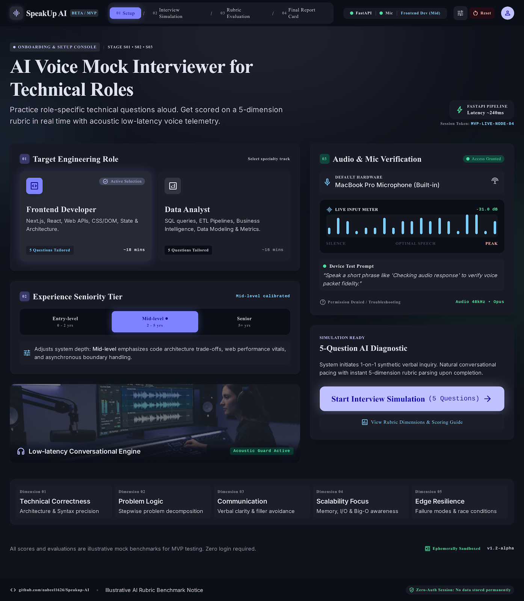
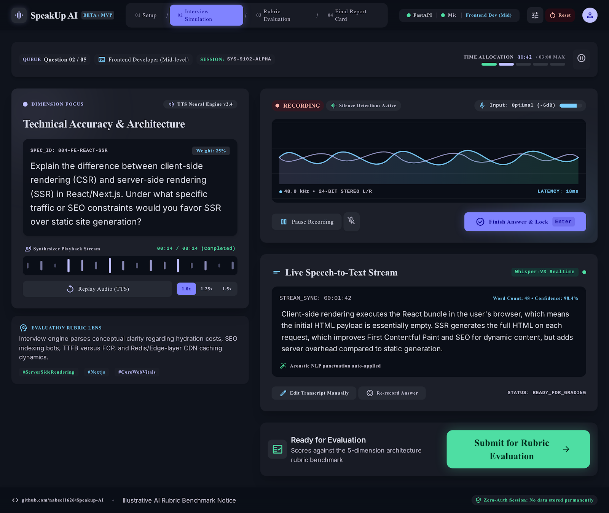
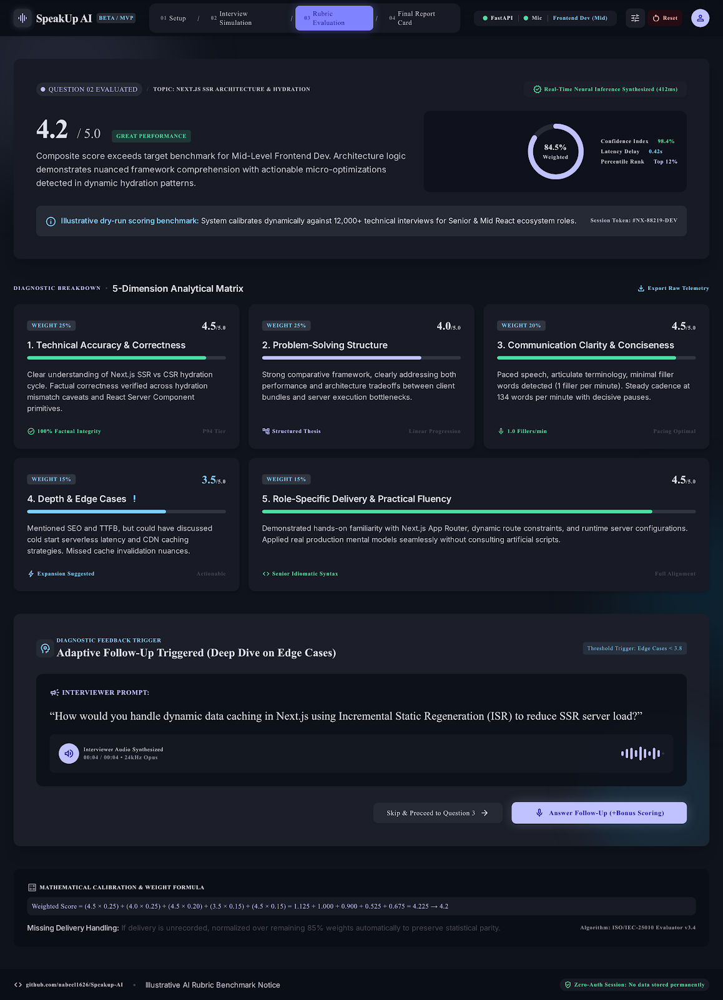
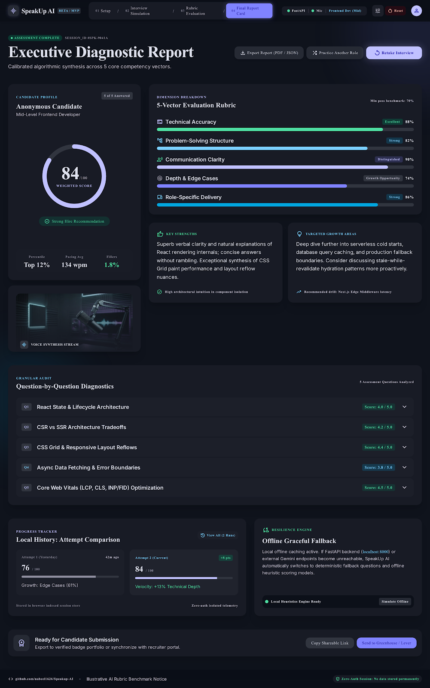
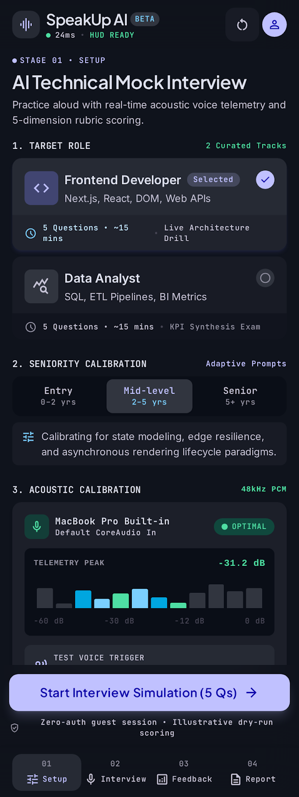
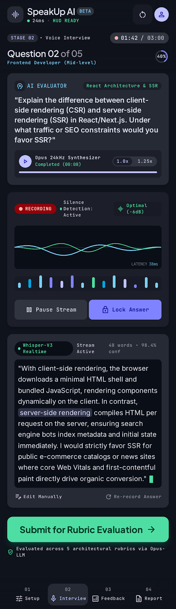
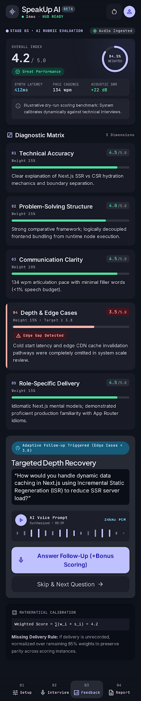
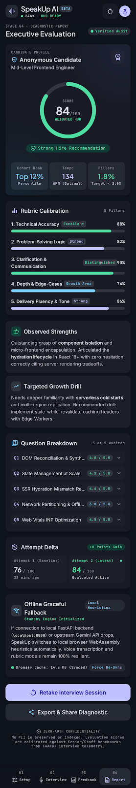

# SpeakUp AI — Mockups

**Design source:** https://stitch.withgoogle.com/projects/9095136876311161326
**Design system:** [DESIGN_SYSTEM.md](DESIGN_SYSTEM.md)
**Status document:** [DESIGN.md](DESIGN.md)

> Mockups are design evidence, not proof that features work.

## Screen inventory

| ID | Name | Desktop | Mobile | Implemented? |
|---|---|---|---|---|
| S01 | Landing | [PNG](mockups/desktop/S01-S03-role-setup-mic.png) · [HTML](mockups/desktop/S01-S03-role-setup-mic.html) | [PNG](mockups/mobile/S01-S03-role-setup-mic.png) · [HTML](mockups/mobile/S01-S03-role-setup-mic.html) | No |
| S02 | Role selection | same | same | No |
| S03 | Mic permission | same | same | No |
| S04 | Voice interview Q1 | [HTML](mockups/desktop/S04-S06-interview-1.html) | [PNG](mockups/mobile/S04-S06-interview.png) · [HTML](mockups/mobile/S04-S06-interview.html) | No |
| S05 | Transcription | same | same | No |
| S06 | Voice interview Q2 | [PNG](mockups/desktop/S04-S06-interview-2.png) · [HTML](mockups/desktop/S04-S06-interview-2.html) | same | No |
| S07 | Rubric feedback | [PNG](mockups/desktop/S07-S09-rubric-feedback.png) · [HTML](mockups/desktop/S07-S09-rubric-feedback.html) | [PNG](mockups/mobile/S07-S09-rubric-feedback.png) · [HTML](mockups/mobile/S07-S09-rubric-feedback.html) | No |
| S08 | Dimension breakdown | same | same | No |
| S09 | Improvement drill | same | same | No |
| S10 | Final report card | [PNG](mockups/desktop/S10-S12-report-offline.png) · [HTML](mockups/desktop/S10-S12-report-offline.html) | [PNG](mockups/mobile/S10-S12-report-offline.png) · [HTML](mockups/mobile/S10-S12-report-offline.html) | No |
| S11 | Offline recovery | same | same | No |
| S12 | History | pending | pending | No |

## Embedded mockups — Desktop

### S01–S03 — Role setup and microphone check

### S04–S06 — Voice interview and transcription (part 1)
_No PNG exported by Stitch for this screen range. HTML only:_
[View HTML](mockups/desktop/S04-S06-interview-1.html)

### S04–S06 — Voice interview and transcription (part 2)

### S07–S09 — 5-dimension rubric feedback

### S10–S12 — Final report card and offline recovery

## Embedded mockups — Mobile

### S01–S03 — Role setup and microphone check

### S04–S06 — Voice interview and transcription

### S07–S09 — 5-dimension rubric feedback

### S10–S12 — Final report card and offline recovery

## Walkthrough

1. S01 → S02 → S03: entry, role/level selection, mic permission.
2. S04 → S05 → S06: AI question, voice answer, transcription.
3. S07 → S08 → S09: rubric scoring, dimension breakdown, improvement drill.
4. S10 → S11 → S12: final report card, offline recovery, history.

## Mockup vs implementation

Implemented in the app:
- `GET /api/health`
- `POST /api/generate-questions` (Gemini with fallback)
- Next.js starter page

No screen S01–S12 is implemented.

## Gaps

- Mockups generated by Stitch AI as design references.
- Sample scores and feedback are illustrative, not test evidence.
- Desktop mockups: 4 PNGs + 5 HTMLs. One PNG (S04-S06-interview-1) was not
  exported by Stitch; the HTML for it is present.
- Mobile mockups: 4 PNGs + 4 HTMLs.
- S12 (History) is not in the current mockup set.
- HTML mockups are static, not interactive prototypes.